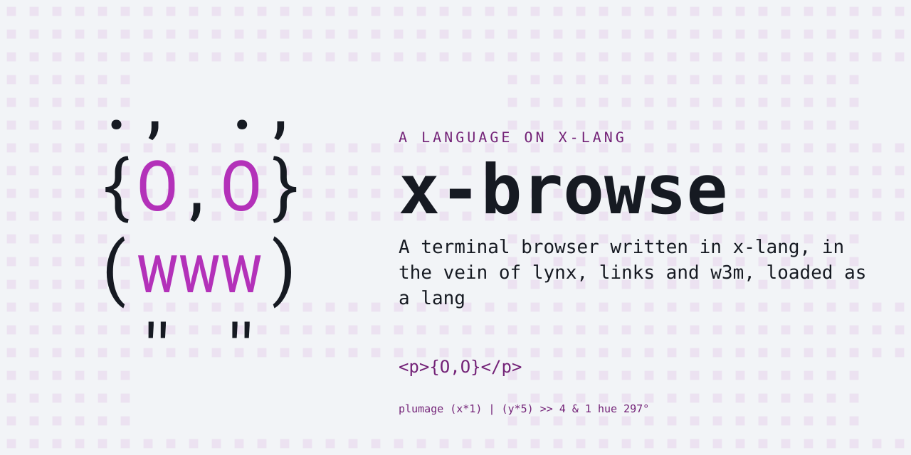

# x-browse

A terminal browser written in
[x-lang](https://github.com/jonruttan/x-lang), in the vein of lynx, links
and w3m, loaded as a lang.  It browses Markdown and HTML: headings, bold,
italic, code, quotes, lists, links and forms drawn with the terminal's
attributes, in tabs, and PNG and GIF images in half-block characters.  It runs no
scripts, applies no stylesheets and keeps no cookies.

    x -l browse -- [LOCATION ...]
    x -l browse -- -d [-w N] LOCATION
    x -l browse -- -t FORMAT LOCATION
    x -l browse -- -V | -h

A location is a path, a `file://`, `http://` or `https://` url, a `data:`
url, or `about:help`.
Each location given opens in a tab of its own; with none, the browser
opens the current directory.  A file ending `.md`, `.markdown` or
`.mdown`, or a response of type `text/markdown`, is read as Markdown; one
ending `.html` or `.htm`, or a response of type `text/html`, as HTML,
shown as the same headings, lists, quotes, code and links, a table as a
line a row; a directory is shown as a list of its entries, linked;
anything else is shown as text.  A file or response whose bytes start
`%PDF-` is a PDF, whatever its name or type: its text is shown as
headings and paragraphs, read from where the file places its glyphs.

## Keys

    j Down          a line down            k Up           a line up
    Space f PgDn    a page down            b PgUp         a page up
    d               half a page down       u              half a page up
    g Home          the top                G End          the bottom

    Tab             the next link or field p              the previous one
    Enter Right l   follow the link        t              follow it in a new tab
    Left h BS       back
    o               open a location        O              open one in a new tab
    r               load the document again

    Enter           on a text field, type its text; on a checkbox or a radio
                    button, turn it on or off; on a select, its next option;
                    on a button, send the form (t sends it to a new tab)

    / Ctrl-S        search for text        n              the next match
                                           N              the previous match

    ] >             the next tab           [ <            the previous tab
    1-9             that tab               x              close this tab

    ?               the keys, in a new tab
    Ctrl-L          draw the screen again
    q Ctrl-C        quit

The bar at the top lists the tabs, the current one bold.  The bottom
line shows where the selected link goes, or with none selected where the
document is, and on the right the lines shown and how many there are.

A link is resolved against the document it is in, as a browser
resolves a relative url.  A link's `#fragment` goes to the heading whose
GitHub slug it is.  Each tab keeps the documents it came from; going
back shows one where it was left, the same link selected.

A search is for text in any case, from the top line shown: the line it
is found on goes to the top.  `n` looks on from the last match while it
is on the screen, otherwise from the top line; `N` looks back the same
way.  `/` with nothing typed searches for the last text again.

A form's fields are drawn as lynx draws them: a text field as its text
padded with underscores, a checkbox as `[ ]` or `[X]`, a radio button as
`( )` or `(*)`, a select as its chosen option in brackets, a button as
its label in brackets.  They are selected as links are, and the bottom
line says what the selected one is.  `Enter` on a button sends the form:
by GET it opens the action with the fields as the query, by POST it
sends them as the body, `application/x-www-form-urlencoded`.  What is
typed into a form stays with the document in its tab, so going back
finds it as it was left.

## --dump

`-d`, `--dump`, writes the document as text on standard output, laid out
`-w N`, `--width N`, columns wide (80 when not given), as lynx's `-dump` does: each link's text
led by its number in brackets, a form's fields drawn as the browser draws
them, and after the document the list of where the links go.  A PNG or GIF
image is written as its picture in half blocks and 24-bit colour, no
wider than the columns.

## --to

`-t FORMAT`, `--to FORMAT`, writes the document on standard output in a
format: `text`, as `--dump` writes it, or `html`, a page holding the
document's blocks under its title.  A Markdown file, an HTML page or a
PDF goes in and HTML comes out; a text file is one code block, and an
image has no HTML form.

    x -l browse -- -t html notes.md > notes.html
    x -l browse -- -t html paper.pdf > paper.html

## Images

An image in a page is its alternative text in brackets, a link to the
image.  Enter on it shows the image fitted to the window, two pixels a
character cell in half blocks; the back keys return.  `i` shows a page's
images inline, each below its brackets, fitted to the page's width and a
row short of the window, and `i` again puts them back to links; it holds
for every tab.  An image is loaded once a location while the browser
runs, and one that does not load, or is not a PNG or a GIF, stays a link.  A
location whose
bytes are a PNG or a GIF opens as an image, whatever its name or type; a
GIF shows its first image, so an animation stands still.  Colours
are 24-bit when `COLORTERM` is `truecolor` or `24bit`, else the nearest
of the 256-colour palette.

## https

https is x-lang's own TLS 1.3, written in x.  The server's certificate is
checked against Mozilla's roots for the host.  Neither has had an
independent review.

## Install

It needs x-lang v0.57.0, the release `lang.xon` declares.

    make install    # into <share>/langs/browse

## Tests

    make test X=/path/to/x
    make check X=/path/to/x

## Not yet

Images other than PNG and GIF, images in `data:` urls not in base64, and files
sent from a form.  A table is shown a line a row.  A PDF's images, links,
tables and columns, and an encrypted PDF.

## Licence

MIT No Attribution (MIT-0). See [LICENSE](LICENSE).
